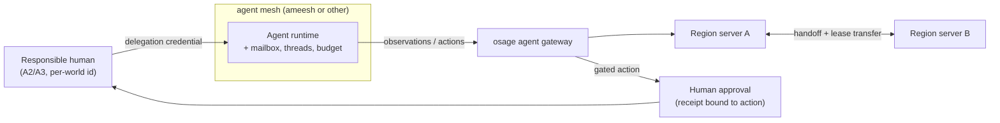

# Design 01 — Accounts, uniqueness and the agent mesh

Status: **proposed** · Date: 2026-11-09

Two things are built into the world-server mesh **from the first version**, because retrofitting them later would mean changing the protocol, the persistence model and every client:

1. **Account uniqueness** for human users — against fraud, ban evasion, multi-account farming, smurfing and bot armies.
2. **An agent mesh** inside the server mesh — AI agents as first-class, accountable participants of the world.

Both are **interfaces with pluggable providers**. osage names two reference implementations — **nexlink** for identity and **ameesh** for agents — and **imposes neither**: a world can run with other providers, or with none.

## 1. Principles

| # | Principle |
|---|---|
| P1 | **Uniqueness is required only where privilege is scarce.** Walking around, reading, chatting, building in a sandbox: open to anyone, even anonymous guests. Anything that is fungible or bounded — tradable value, ownership of land or rare assets, ranked play, moderation powers, vouching for others — requires a proven unique human. N accounts posting N times is just posting; N accounts receiving N rewards is theft. |
| P2 | **The world never needs to know who you are, only that you are one.** Deduplication happens at the identity provider. The world receives a **stable per-world identifier** (a pairwise pseudonym, or *nullifier*) plus an assurance level — never civil identity. Two accounts of the same person in the same world map to the same identifier; the same person in two worlds cannot be correlated unless they choose to. |
| P3 | **Sanctions bind to the per-world identifier, not to the account.** A ban follows the person within the world (or within a federation of worlds that opts in to a shared scope). Evading it means obtaining a new unique identity from a provider, which is exactly what a good provider makes costly. |
| P4 | **Every agent has a responsible human.** An agent joins a world only with a delegation from a uniqueness-attested human. It acts under that human's accountability, sanctions and the quotas the world sets: one human cannot multiply themselves by running agents. |
| P5 | **The controller kind is always known.** The protocol always carries each entity's controller kind (`human`, `agent` or `system`), so every client and world can show it. The rules built on it — where agents may go, ranked modes, quotas — belong to each world, not to osage ([D-008](decisions.md#d-008--game-rules-for-agents-belong-to-each-world-not-to-osage)). |
| P6 | **Irreversible or costly actions go through a gate.** Trading valuable items, spending currency, destroying shared builds, moderation: when an agent proposes them, they need a human approval receipt bound to that exact action, single-use and with expiry. |
| P7 | **Open standards at the boundary, no provider lock-in.** Identity crosses the boundary as W3C Verifiable Credentials / DIDs (presented with OpenID for Verifiable Presentations); agent delegation as a signed, scoped, expiring credential. Any provider that speaks them can plug in. |

## 2. Account uniqueness

### 2.1 Assurance levels (world-facing)

| Level | Meaning | Typical source |
|---|---|---|
| **A0** | Anonymous guest, no attestation | none |
| **A1** | Account controlled by someone (device key, e-mail, phone) — not proven unique | any login |
| **A2** | **Unique human, community-attested** — other people vouched, no documents | social validation (e.g. nexlink) |
| **A3** | **Unique human, documented** — civil documents checked by the provider | document-based providers, government eID wallets |

Each world declares a **policy**: which providers and issuers it trusts, and which level gates which privilege. Example default:

| Privilege | Minimum level |
|---|---|
| Visit, chat, sandbox build | A0 |
| Persistent avatar, inventory | A1 |
| Trade, own land or rare assets, ranked play, run agents | A2 |
| Withdraw value out of the world, moderation powers, vouch for others | A3 or world-specific |

### 2.2 Flow

```mermaid
sequenceDiagram
  participant C as Client (any tier)
  participant P as Identity provider (nexlink, eID wallet, …)
  participant W as osage world (region server)
  C->>W: join (A0 guest or A1 account)
  W-->>C: privilege needs A2 → presentation request (issuers, level, world scope)
  C->>P: request presentation for world scope
  P-->>C: VC: unique human, level A2, per-world identifier, status
  C->>W: verifiable presentation
  W->>W: verify signature, status, policy; bind account → per-world identifier
  Note over W: duplicate identifier → second account refused or merged,<br/>sanctions looked up by identifier
```

### 2.3 What the world stores

- the **per-world identifier**, the assurance level, the issuer, the credential's status reference;
- sanctions and reputation keyed by that identifier;
- **never** civil data, and never a provider's global user identifier.

### 2.4 Reference provider: nexlink

**[nexlink](https://www.nexlink.ph)** is a social network "built on trust", where people connect "through socially validated identities": people are validated by other people. That is exactly level **A2**, and the natural first provider adapter. Other providers must fit the same interface — for example government eID wallets (the EU Digital Identity Wallet) for A3, or other proof-of-personhood systems — so that no world depends on one company.

## 3. The agent mesh inside the server mesh

### 3.1 What an agent is in an osage world

An agent is a client at tier **T0** (no rendering) that:

- holds a **delegation credential** issued by its responsible human (scope: world, regions, allowed actions, quotas, expiry);
- receives **interest-managed structured observations** (only what its avatar could perceive) and sends **actions** through the agent gateway;
- counts against its human's **quotas**, set by the world (concurrent agents, actions per minute, value moved per day);
- carries the `agent` controller kind, visible to every client.

### 3.2 How it fits the server mesh

- **Placement follows the world.** When the region an agent acts in hands an entity off to another region server, the agent's session lease moves with it. The agent runtime itself may live anywhere: on the responsible human's machines, in the world operator's cluster, or in a provider's mesh.
- **Coordination is first-class.** Agents of a team exchange messages through a mailbox, and every exchange is appended to a readable thread that the responsible humans can audit.
- **Budgets and caps** per agent and per human are enforced by the gateway, not by the agent.
- **Gated actions** (P6) return a *pending* state until a human approval receipt arrives; an unknown outcome is reconciled, never retried blindly.



### 3.3 Reference mesh: ameesh

**[ameesh](https://github.com/manaty/ameesh)** (AGPL-3.0, [ameesh.org](https://ameesh.org)) — "accountable teams of humans and AI agents" — already implements the pieces this design needs, outside games: a durable mailbox, one runner per host, agent **leases**, readable threads, **actions behind a gate**, **human approvals proved by passkey receipts**, and a canon that declares humans, hosts, agents and placements — **an agent without a resolved responsible human is never claimed**. It runs agents from several vendors' harnesses side by side. It is the natural first agent-mesh adapter, and also a candidate for coordinating the human + agent teams that build osage itself.

## 4. Protocol consequences (to put in protocol v0)

- Join handshake carries an optional **verifiable presentation** (identity) or **delegation credential** (agent).
- Every entity controlled by a participant carries its **controller kind** (`human` | `agent` | `system`) and, for agents, the per-world identifier of the responsible human.
- **Action messages** may return `pending_approval` with an approval request reference.
- **Sanction and policy queries** are server-side only; clients see only their own privileges.
- Interfaces: `IdentityProvider` (verify presentation → `{per_world_id, level, issuer, status}`), `AgentMesh` (lease, mailbox/thread hooks, approval receipts). Dev builds ship a **local test provider** and a **local test mesh** so nothing external is required to develop or play.

## 5. Open questions

1. ~~Cross-world sanctions~~ — decided: voluntary federations only ([D-007](decisions.md#d-007--cross-world-sanctions-only-within-voluntary-federations)).
2. ~~Default policy~~ — decided: the table of §2.1 ([D-006](decisions.md#d-006--default-identity-levels-a2-for-scarce-privileges-a3-to-take-value-out)).
3. ~~Agents in competitive play~~ and 4. ~~agent quotas~~ — decided: each world's rules, not osage's; osage provides the mechanisms ([D-008](decisions.md#d-008--game-rules-for-agents-belong-to-each-world-not-to-osage)).
5. ~~Provider diversity~~ — decided: a generic verifier, proven with nexlink (A2) and an EUDI wallet or national eID (A3) before phase 2 ([D-013](decisions.md#d-013--identity-a-generic-verifier-tested-with-two-different-providers-before-phase-2)).

## Licences

ameesh is AGPL-3.0, compatible with osage's AGPL-3.0. nexlink and other identity providers are reached over the network through open standards — no code linking, so no licence constraint on either side.
