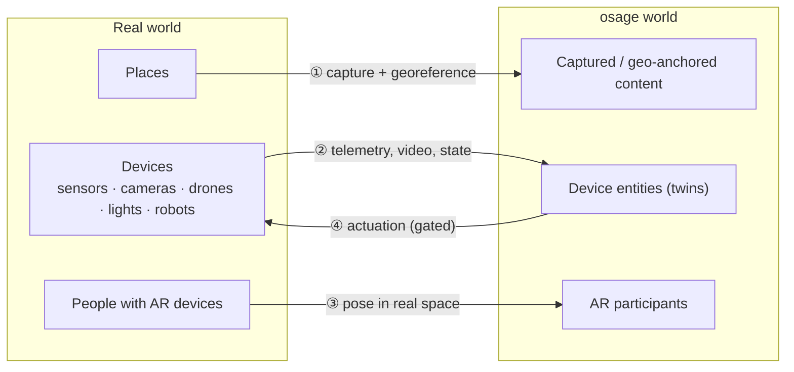
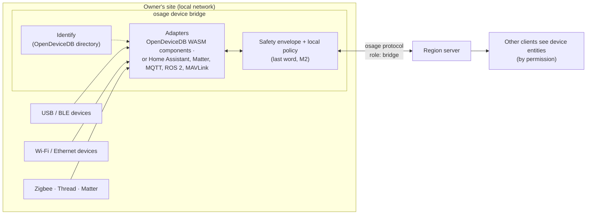

# Design 02 — Mixed worlds: real places, real devices, and OpenDeviceDB

Status: **proposed** · Date: 2026-11-09

An osage world may be purely virtual, or **mixed**: real places captured and anchored in it, real devices living in it as entities, people present physically through AR, and in-world actions driving real devices. Like accounts and agents ([design/01](01-accounts-and-agents.md)), this has to be in the protocol from v0: device entities, timestamps and staleness, georeferencing and physical actuation cannot be bolted on later.

The natural partner is **[OpenDeviceDB](https://opendevicedb.org)** ([repo](https://github.com/opendevicedb/opendevicedb)) — an open directory of 29,000+ devices whose protocols or firmware are already open, with a JSON API, an MCP server for agents and a draft specification for composable device applications. As with nexlink and ameesh, osage **uses it as the reference and imposes nothing**: other device ecosystems plug into the same interface.

## 1. The four flows of a mixed world

| Flow | What it means | Hard part |
|---|---|---|
| ① Real places → world | A space is scanned (photos, drone, phone) and reconstructed (Gaussian splats or meshes), then anchored to real coordinates | precision, privacy of interiors, streaming large captures |
| ② Real devices → world | A device appears as a live entity: state, measurements, video | identification, protocols, clocks and staleness |
| ③ Real people → world | Someone in the real place joins through an AR client; their position maps into the world | tracking, anchors, georeference |
| ④ World → real devices | An in-world action changes something physical | **safety, permissions, liability** |

## 2. Principles

| # | Principle |
|---|---|
| M1 | **A real device is authoritative over its own state.** The world mirrors it with source timestamps and a staleness state; an old frame or measurement is never shown as current. |
| M2 | **The bridge has the last word on safety.** Safety envelopes (geofences, speed and power limits, rate limits, allowed functions) are enforced **locally**, next to the device — never only in the world server. A compromised or lagging world cannot push a device outside its envelope. **A watchdog stops any moving device when the world link stops validating it**, and a local emergency stop always works. This is the shape the EU Machinery Regulation 2023/1230 requires from 2027 for remote-controlled machines ([research/05 §6](../research/05-mixed-reality-standards.md#6-safety-and-regulation-of-remote-actuation)). **Regulatory safety functions are never bypassed** (drone Remote ID, geofencing, radio power limits — OpenDeviceDB's policy P5, inherited as is). |
| M3 | **Physical actuation is a gated action** ([design/01](01-accounts-and-agents.md) P6). osage defines the risk classes — **read-only, pre-approved, gated (human approval), on-site operator only, forbidden** — and the bridge ships **read-only**; only the device's owner raises a class, never the world ([D-009](decisions.md#d-009--physical-actuation-risk-classes-read-only-by-default-the-owner-decides)). Permission is granted per device × function × participant by the owner. Agents need a human approval receipt for any physical effect outside a low-risk set pre-approved by the owner. Actions are never replayed automatically after a reconnection. |
| M4 | **Only verified adapters may actuate.** An adapter whose behaviour has not been verified on real hardware (with a stated firmware) is read-only by default. |
| M5 | **Local-first, no vendor cloud by default.** Devices stay on their owner's network; the bridge publishes only what the owner shares, to whom they share it. |
| M6 | **Privacy policy belongs to operators and owners, not to osage.** osage imposes no privacy policy on real cameras, microphones or captured places ([D-010](decisions.md#d-010--privacy-of-real-cameras-and-captured-places-osage-imposes-nothing)). It provides the **mechanisms** — per-stream permissions set by the owner, server-side interest management, a recording/streaming state carried by the protocol so clients and devices can signal it. World operators and device owners decide how to use them, and carry the responsibility: a shared world likely falls outside the GDPR household exemption, making them data controllers ([research/05 §7](../research/05-mixed-reality-standards.md#7-privacy)). |
| M7 | **One contract vocabulary.** Device data and commands in osage use OpenDeviceDB's connection contracts (state, stream, action; units, spatial frame, clock domain, session) — no parallel vocabulary. **The contracts live and are versioned in OpenDeviceDB**; osage consumes them and contributes to them, including the continuous-control contract written jointly ([D-011](decisions.md#d-011--device-contracts-live-in-opendevicedb)). Device *descriptions* are **W3C WoT Thing Description 1.1 documents published by OpenDeviceDB** ([D-012](decisions.md#d-012--opendevicedb-publishes-wot-thing-descriptions)), onto which those contracts map directly (state → property, stream/event → event, action → action), so twins stay interoperable with Eclipse Ditto, node-wot and other WoT tools. |

## 3. The link with OpenDeviceDB

### 3.1 What OpenDeviceDB brings to osage

| OpenDeviceDB piece | Role in an osage mixed world |
|---|---|
| **Device directory** — identifiers (USB, BLE name, FCC id), interfaces and transports, status of the open protocol or firmware, whether the vendor cloud is still needed | The bridge **identifies** a device and knows **how it can be reached**, and whether it can join a world **without its vendor's cloud** (M5) |
| **Browser detection** (`/detect/`, by USB id or Bluetooth name) | A **zero-install bridge**: in a browser client, plug or pair a device and it appears in the world |
| **Composable components** (draft spec, pilot): *adapters* talk to a device, *processing* transforms data (e.g. images → 3D), *interfaces* show results or emit control intentions; WASM, sandboxed, declared permissions; hosts: browser, desktop, mobile, server | The bridge **runs OpenDeviceDB adapters** to talk to devices; osage's content pipeline **runs processing components** (e.g. spatial capture); the same WASM artifact works on every host — the same "any client" idea as osage |
| **Connection contracts** — `odb.video.frame/1`, `odb.camera.calibration/1`, `odb.scene.revision/1`, measurements with units; kinds *value/state*, *stream/event*, *action*; spatial frame, clock domain, session; actions never auto-replayed; bounded queues | The **type system of device entities** in osage (M7) and of their protocol messages |
| **MCP server** — `search_devices`, `lookup_device`, `claim_device`, `publish_findings`, `request_device` | An osage agent wanting to bring a device into a world **looks it up first**; if nothing exists, it claims the device, reverse-engineers it and **publishes its findings back** |
| **Verification** — every interface carries a confidence; the "verified" badge needs a replayable hardware test with a stated firmware | Feeds M4: actuation only through verified adapters |
| **Policy P5** — no hosting of proprietary firmware or keys; nothing that defeats a regulatory safety function | Inherited by osage's mixed-world policy (M2) |
| **Same licence pattern** — code AGPL-3.0-or-later, data CC BY-SA 4.0 | Compatible with osage |

### 3.2 What osage brings back to OpenDeviceDB

- **A shared, spatial, multi-user host for compositions.** Today a composition ends in a 3D view in one page; in osage it can be **placed in a world**, seen and used by several people and agents at once — the spatial-capture reference case becomes "scan a place and walk in it together".
- **Server and desktop hosts.** osage needs a WASM runtime for components on native clients and bridges; it can be the desktop/server host that OpenDeviceDB's spec plans but has not built.
- **Hardware evidence.** With the owner's consent, real use in worlds produces test reports (function, firmware, environment) that feed OpenDeviceDB's verification.
- **Demand.** Devices people want in their worlds become OpenDeviceDB requests ("wanted"), which point contributors and agents at the useful work.
- **Continuous control.** OpenDeviceDB's first contracts deliberately exclude continuous control loops. Drones, robots and vehicles in mixed worlds need one; it should be **specified jointly**, with timing and stop behaviour.

## 4. Architecture: the device bridge

- **Where a bridge runs:** a browser tab (WebUSB, Web Bluetooth and WebHID in Chromium-based browsers; Web Serial also in Firefox 151+; **nothing in Safari**), the desktop or native client, a home server or single-board computer, a phone.
- **Who a bridge is:** a participant bound to the **responsible human who owns the devices** (their per-world identifier, [design/01](01-accounts-and-agents.md)). Device entities are owned by that human; permissions and sanctions follow them.
- **Adapters, not lock-in:** OpenDeviceDB components are the reference, covering the long tail of reverse-engineered devices. Devices that speak a published standard are reached through existing ecosystems plugged in as alternative backends: **Matter** (cameras since 1.5), **Home Assistant** (~1,560 integrations, WebSocket API, MCP), **MQTT / Sparkplug**, **ROS 2** (no Bevy crate yet: r2r or rclrs), **MAVLink / MAVSDK** for drones, **ONVIF / RTSP** cameras relayed to WebRTC (go2rtc, MediaMTX, WHIP).

## 5. Real places and georeferencing

- **Captured places.** Spatial capture (the [Spatial Capture 3D](https://github.com/smichea/spatial-capture-3d) package is OpenDeviceDB's functional reference) produces Gaussian splats or meshes. The open pipeline exists end to end: COLMAP/GLOMAP (BSD-3) for structure from motion, gsplat or **Brush** (Rust/WebGPU, Apache-2.0) for splat training, glTF with **`KHR_gaussian_splatting` (ratified Sep 2026)**, then 3D Tiles for streaming to every client tier; who may see a captured place is set by its owner and the world operator (M6).
- **Georeference.** A world, or a region of it, may declare an Earth frame (origin and orientation in WGS84/ECEF); poses in that frame use **OGC GeoPose 1.0**. Devices with GNSS (drones) and AR clients map into it; virtual-only worlds simply have none. This reuses the large-world coordinate handling an open world needs anyway (big_space on Bevy, floating origin on Babylon).
- **AR clients.** A new client kind: a phone or headset in the real place, rendering virtual content over the real view on a T1–T2 budget, reporting its pose in the world frame. WebXR AR works in Chrome Android, Quest Browser and Android XR; **iPhone AR needs a native client** (no WebXR in Safari iOS).
- **Relocalisation without proprietary clouds.** There is no turnkey open visual positioning system; `osage-geo` assembles one from open pieces (OpenArCloud OSCP, stella_vslam, Kapture) instead of depending on Google, Apple or Niantic.

## 6. Scenarios

1. **2030workspace.** The virtual office mirrors the real one: meeting-room occupancy and air-quality sensors, displays and lights in the real rooms appear on their virtual counterparts; server-room temperature and cooling devices show on the infrastructure islands. Turning a real light on from the virtual office is a low-risk action the owner pre-approved.
2. **Drone scan.** A small drone (e.g. one with an open LAN client, such as the [DJI Neo 2 LAN client](https://github.com/smichea/dji-neo2-lan-client)) streams pose and video into the world; its images feed spatial capture; the scanned place becomes part of the world. **Flight commands come from an on-site pilot keeping visual line of sight** — flying a real drone remotely from the world is beyond visual line of sight, not allowed in the EU open category nor under US Part 107 without a waiver. Remote participants watch, annotate and suggest. The envelope is enforced on the bridge; Remote ID and geofencing are untouched.
3. **Game world with real effects.** In-game events change real lights or sounds in players' rooms — opt-in, low-risk set only, enforced locally.

## 7. Protocol consequences (v0)

- Entity kind **`device`**, whose components are typed by OpenDeviceDB contracts; every value carries **source timestamp, clock domain and staleness**.
- Join handshake role **`bridge`**, bound to the owner's identity.
- **Actuation messages** are gated actions with device × function × participant permissions and a `pending_approval` state; no automatic replay.
- **Georeference metadata** per world or region; AR clients report pose in that frame.
- Device and capture streams go through interest management **and** owner permissions (M6).

## 8. Modules

| Module | Scope | Builds on |
|---|---|---|
| `osage-bridge` | device bridge host: WASM runtime for OpenDeviceDB components, safety envelope, local policy; alternative backends (Home Assistant, Matter, MQTT, ROS 2, MAVLink) | OpenDeviceDB components and contracts (reference) |
| `osage-geo` | georeference, Earth frames, AR anchors and AR client support | 3D Tiles, large-world coordinates |
| `osage-content` (extended) | ingest of captured places (splats, meshes) into streamable tiles | spatial capture components, `KHR_gaussian_splatting`, 3D Tiles |

## 9. Open questions

1. ~~Risk classes for actuation~~ — decided: classes defined by osage, read-only by default, the owner decides ([D-009](decisions.md#d-009--physical-actuation-risk-classes-read-only-by-default-the-owner-decides)).
2. ~~Where the contracts live~~ — decided: in OpenDeviceDB ([D-011](decisions.md#d-011--device-contracts-live-in-opendevicedb)). Still to write there: images, calibration, measurements, 3D scenes, actions, and the joint continuous-control contract for drones and robots.
3. **Component licences:** OpenDeviceDB ports keep their upstream licences; which are compatible with being loaded by an AGPL-3.0 bridge (sandboxed WASM modules exchanging messages) needs a review.
4. **Embedding compositions:** can an OpenDeviceDB composition be placed in a world as is, or through an osage wrapper?
5. ~~Privacy defaults~~ — decided: no policy imposed by osage, mechanisms only ([D-010](decisions.md#d-010--privacy-of-real-cameras-and-captured-places-osage-imposes-nothing)).
6. ~~WoT TD export~~ — decided: OpenDeviceDB publishes the Thing Descriptions ([D-012](decisions.md#d-012--opendevicedb-publishes-wot-thing-descriptions)).

Standards, versions and regulations behind this note: [research/05](../research/05-mixed-reality-standards.md).
