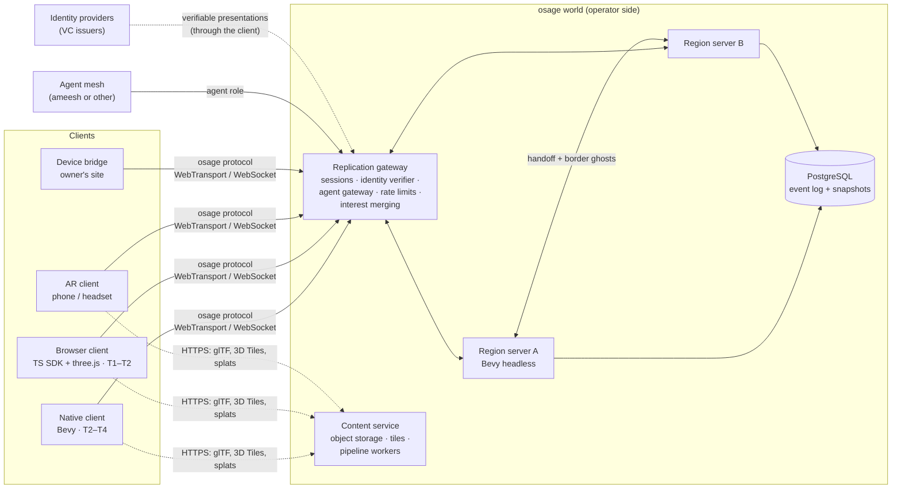

# ADR-0001 — Architecture

Status: **accepted** · Date: 2026-11-09

Gathers the decisions of the [decision log](../decisions.md) (D-001 to D-019) into one architecture. Goals G1–G6 are in the [synthesis](../../research/00-synthesis.md#goals).

## 1. Overview

## 2. Responsibilities

| Process | Responsibility | Not its job |
|---|---|---|
| **Replication gateway** | terminates client connections (WebTransport, WebSocket); verifies identity presentations and agent delegations (D-013); enforces rate limits, quotas and permissions; issues agent delegations; subscribes to the regions each client's interest area touches and **merges their streams**, so region boundaries and handoffs are invisible to clients (D-016) | simulation, persistence; MCP — agents use the client-side `osage-agent-mcp` adapter (D-026) |
| **Region server** | authoritative simulation of one area (Bevy ECS, headless); interest management inside the area; border ghosts and entity handoff with neighbouring regions; appends events to the log | client connections, identity |
| **Persistence** | PostgreSQL event log + periodic snapshots per region (D-004); replay and audit (sanctions, gated actions, time travel) | live state (regions hold it) |
| **Content service** | stores and serves content by reference (glTF + KTX2 + meshopt, 3D Tiles HLOD, splats), per-tier variants; runs pipeline workers (tiling, capture processing, OpenDeviceDB compositions if the operator allows, D-015) | live state |
| **Device bridge** | runs next to the owner's devices; identifies them (OpenDeviceDB), runs adapters (WASM in process or out of process, D-014), enforces the safety envelope, watchdog and emergency stop locally (D-009); joins the world with the `bridge` role | world policy |
| **Clients** | render the world at their tier, send intents and actions, stream content; never authoritative over shared state | |

## 3. Interfaces

| Interface | Public? | Specified by |
|---|---|---|
| Client ↔ gateway (osage protocol) | **public**, Apache-2.0 spec | [ADR-0002](0002-protocol-v0.md) |
| Content (HTTPS, glTF, 3D Tiles) | public, open standards | Khronos, OGC |
| Identity (W3C VC, OpenID4VP) | public, open standards | W3C, OpenID Foundation |
| Device contracts | public | OpenDeviceDB (D-011, D-012) |
| Gateway ↔ region, region ↔ region | **internal** in v0, may change freely | code |

## 4. Deployment profiles

- **Single binary (development, phase 1):** gateway, one region server and the content service in one process, PostgreSQL alongside; a local test identity provider and a local test agent mesh, so nothing external is needed.
- **Cluster:** gateways and region servers scale separately (gateways by connection count, regions by simulated area and load); Kubernetes; Agones is an option for region fleets, not a requirement.

## 5. Repository layout (when code starts)

| Path | Contents | Licence (D-003, D-005) |
|---|---|---|
| `spec/` | protocol specification text | Community Specification License 1.0 (D-023) |
| `spec/proto/`, spec examples | `.proto` schemas and examples | Apache-2.0 |
| `crates/osage-sdk/` | Rust client SDK | MIT OR Apache-2.0 |
| `crates/osage-credentials/` | v0 identity credentials and agent delegations | MIT OR Apache-2.0 |
| `crates/osage-agent/` | MCP adapter for AI agents (`osage-agent-mcp`, D-026) | MIT OR Apache-2.0 |
| `packages/sdk-ts/` | TypeScript client SDK | MIT OR Apache-2.0 |
| `crates/osage-gpu-plugin-api/`, `crates/osage-platform-api/`, `crates/osage-world-module-api/` | interfaces for vendor GPU components, platform components and world modules (§A, §C, §D) | MIT OR Apache-2.0 |
| `crates/osage-*` (others) | gateway, region server, persistence, content, bridge, render plugins, native client, tools | AGPL-3.0-or-later WITH osage-exceptions-1.0 (D-020) |
| `packages/client-three/` | three.js browser client | AGPL-3.0-or-later WITH osage-exceptions-1.0 |
| separate repository | out-of-process component runner for the bridge (D-014) | MIT |
| `research/`, `design/` | documentation | CC BY-SA 4.0 |

Bevy is pinned to one version per osage release (D-001).

## 6. Consequences

- Clients stay simple — one connection, no region logic — which matters because there are several client implementations (Rust, TypeScript, agents, bridges).
- The gateway is a scaling and availability point of its own; it holds no authoritative state, so it can be restarted or replicated.
- Only the client ↔ gateway protocol is a public contract in v0; the internal gateway/region protocols can evolve while server meshing is designed.

## 7. Out of scope for v0

Automatic region splitting and load balancing (server meshing proper), consoles, ray-traced tiers, the world editor.
