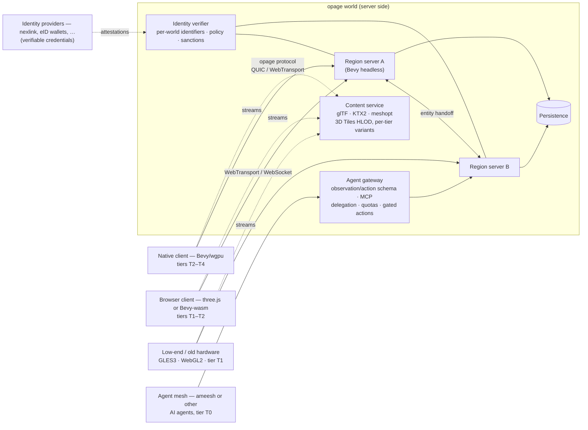

# 00 — Synthesis and recommendation

Date: **2026-11-09**. Built on the four surveys in this folder:
[01 native engines](01-native-engines.md) · [02 browser clients](02-web-engines-webgpu.md) · [03 world server & replication](03-world-server-replication.md) · [04 rendering vs RAGE](04-rendering-vs-rage.md).

## Goals

| # | Goal |
|---|---|
| G1 | **Rendering at the level of Rockstar's RAGE** (GTA 6) on high-end hardware |
| G2 | **Scales down to any hardware**, old machines included |
| G3 | **Modular**, so many teams of humans and AI agents can work in parallel on the engine and all its tools |
| G4 | **Any kind of client joins the same world**: native, browser, mobile, low-end, headless AI agents — each at its own fidelity |
| G5 | **Trust from day one**: account uniqueness against fraud, ban evasion and bad players; AI agents as accountable participants — through pluggable providers, none imposed ([design/01](../design/01-accounts-and-agents.md)) |

First consumer: **2030workspace**, a 3D virtual workspace for IT teams, today a three.js web client.

## What the surveys show

- **Rendering (04):** the best open renderers match *pieces* of GTA 6 in tech demos. Bevy (GPU-driven rendering, meshlet virtual geometry, Solari ray-traced GI) is on the most modern trajectory; Wicked Engine has the broadest feature set but one maintainer; Godot has the broadest community but no GPU-driven path. The harder gaps are **world tools, content pipeline, crowd/traffic simulation and open denoising/upscaling** — the state of the art for the latter is proprietary (NVIDIA, AMD, Intel).
- **Engines (01):** no open engine covers the UE5 open-world stack. Godot = community + low-end/web + editor, but monolithic renderer and plugin-based open world. Bevy = ECS plugins (ideal for G3), modern GPU path, web via wgpu, but no editor and breaking releases. O3DE has weak momentum; Flax is not open source.
- **Browser (02):** WebGPU reaches ~81–89 % of users; **~1 in 5 still needs WebGL2**. three.js r187 now has a GPU-driven meshlet pipeline (WebGPU only); Babylon 9 ships floating origin. **No web engine streams a world** — that has to come from the protocol and content format.
- **Server (03):** nothing open does "one world, any client" end to end. The pieces exist: replication (bevy_replicon, lightyear), transports (WebTransport, now in all major browsers, with WebSocket fallback), content standards (glTF + KTX2 + meshopt inside 3D Tiles HLOD). **Server meshing for a seamless large world** and **a standard agent observation/action interface** do not exist in open source. The platforms that survived (OpenSimulator, Overte) are community-governed and federated; the ones that died were single-vendor stacks.

## Recommendation: neither a fork nor from scratch — build on Bevy, write only the missing layers

**Writing a whole engine from scratch** would spend years rebuilding what Bevy and wgpu already give (ECS, renderer, asset system, Vulkan/DX12/Metal/GLES3/WebGL2/WebGPU backends) before touching what is actually missing. **Forking an engine** creates a dead-end maintained by one community.

**Proposed:** use **Bevy + wgpu** as the foundation of the world server and the native client, **contribute upstream** what belongs in Bevy (rendering, GPU-driven features), and **build opage's own value where nothing exists**: protocol, streaming, server meshing, fidelity tiers, agent interface, world tools.

| Goal | Why Bevy rather than Godot |
|---|---|
| G1 rendering | GPU-driven rendering, meshlets, Solari RT GI are on Bevy's roadmap now; Godot's renderer has none of these and would need a core rewrite |
| G2 any hardware | Godot is better today (Compatibility renderer). Bevy covers GLES3/WebGL2 through wgpu but without compute features — opage must design the low tiers explicitly (see below) |
| G3 modularity | **Bevy's decisive advantage**: everything is a plugin on an ECS, crates have hard boundaries, Rust's compiler and tests give agents fast, strict feedback |
| G4 any client | Same ECS runs headless as server; replicon/lightyear give server-authoritative replication with interest management and browser support; the Bevy Remote Protocol already exposes the world over JSON-RPC (agent access) |

**Risks and mitigations**

- *Breaking Bevy releases every 3–4 months* → pin one Bevy version per opage release, upgrade on a schedule, upstream early to minimise patches.
- *No Bevy editor* → opage needs world tools anyway (G3); build them as BRP clients (web-based), so they work against any running world.
- *Experimental meshlets and Solari* → treat the RT tiers as a research track; tiers T0–T2 must not depend on them.
- *Bus factor of key Bevy subsystems* → opage teams become contributors to those subsystems rather than consumers.

## Proposed architecture

- **One authoritative world**, split into regions; each region is a headless Bevy process. Entity handoff between regions is opage's server meshing.
- **The opage protocol** is the contract: entity/component schema, interest management, snapshots + deltas, versioning. Transport: QUIC/WebTransport, WebSocket fallback.
- **Content is streamed separately** from state, in open formats every client can load: glTF + KTX2 + meshopt packaged as 3D Tiles HLOD; cluster-LOD (meshoptimizer) variants for high tiers. Authoring may use USD/MaterialX, baked to glTF.
- **Agents are clients like any other**, through a gateway that serves interest-managed structured observations and accepts actions (exposed over MCP). **Every agent has a responsible human**, counts against that human's quotas, is labelled as an agent, and needs a human approval receipt for irreversible or costly actions. The agent mesh is a pluggable interface; **ameesh** is the reference implementation.
- **Account uniqueness is built in from v0**: the world receives, from an identity provider, a stable **per-world identifier** and an assurance level — never civil identity. Uniqueness gates only scarce privileges (trade, ownership, ranked play, running agents); sanctions bind to the identifier, so ban evasion requires a new unique identity. Providers plug in through verifiable credentials; **nexlink** (socially validated identities) is the reference A2 provider, none is imposed.
- Details: [design/01 — Accounts, uniqueness and the agent mesh](../design/01-accounts-and-agents.md).

## Fidelity tiers — same world, same source content

| Tier | Clients | Rendering |
|---|---|---|
| **T0** headless | AI agents, bots, tests | none — structured observations |
| **T1** minimal | WebGL2 browsers, GLES3, old integrated GPUs | baked lighting, aggressive HLOD/impostors, CPU culling |
| **T2** standard | WebGPU browsers, mid-range native | GPU culling, clustered lighting, probe GI |
| **T3** high | native Vulkan / DX12 / Metal | GPU-driven, meshlet virtual geometry, dynamic GI without RT, volumetrics |
| **T4** ultra | native with RT hardware | ray-traced GI and reflections (Solari-class), path-traced reference |

The content pipeline produces each tier's derived assets; every tier has a performance budget checked in CI on reference hardware (including an old laptop).

## Module map — for parallel human + agent teams

Each module is a crate or package with a `SPEC.md`, a conformance test suite and owners. Agents take issues scoped to one module; anything that changes the protocol goes through an RFC.

| Module | Scope | Builds on |
|---|---|---|
| `opage-protocol` | schema, interest management, snapshots/deltas, versioning; Rust + TypeScript bindings | replicon / lightyear concepts |
| `opage-server` | headless simulation and authority per region | Bevy, replicon/lightyear |
| `opage-mesh` | region partitioning, entity handoff (server meshing) | **new** |
| `opage-content` | ingest → KTX2/meshopt → cluster LOD → 3D Tiles HLOD, per-tier variants | meshoptimizer, KTX-Software, 3D Tiles |
| `opage-render` | open-world rendering plugins: streaming, HLOD, terrain, vegetation, tier selection | Bevy renderer (contribute upstream) |
| `opage-client-native` | native client app | Bevy |
| `opage-client-web` | TypeScript client SDK + three.js renderer; Bevy-wasm build | three.js, 3DTilesRendererJS |
| `opage-agent` | agent gateway: observation/action schema, MCP server, delegation credentials, quotas, gated actions; `AgentMesh` interface | Bevy Remote Protocol; **ameesh** adapter (reference) |
| `opage-identity` | `IdentityProvider` interface, verifiable-credential verification, per-world identifiers, privilege policy, sanctions | W3C VC / DID, OpenID4VP; **nexlink** adapter (reference) |
| `opage-sim` | crowds and traffic at scale | **new** (Unreal Mass is the reference) |
| `opage-tools` | world editor, inspectors, profiling, PCG — as protocol/BRP clients | **new** |
| `opage-denoise` (long term) | open ML denoiser / upscaler | **new** — the state of the art is proprietary |

## Roadmap (phases, no dates)

0. **Research** (this folder), then ADRs: architecture, protocol v0, licence policy.
1. **Vertical slice — one world, three kinds of client.** One region server (Bevy headless + replicon/lightyear), protocol v0 over WebTransport with WebSocket fallback. The 2030workspace web client, a Bevy native client and an MCP agent join the same world. The world's static content is exported as glTF tiles; the server handles dynamic entities (avatars, moving objects). **Identity and agent interfaces are in protocol v0**: a local test provider and test mesh for development, plus the first nexlink and ameesh adapters; the agent joins with a delegation from a uniqueness-attested human.
2. **Scale.** Streaming + HLOD through 3D Tiles, multi-region handoff, tiers T1–T3, CI performance budgets.
3. **High end.** Upstream work on Bevy meshlets, Solari and GPU-driven rendering; open-world rendering plugins; crowds/traffic; open denoiser research.
4. **Tools.** World editor, PCG, content pipeline at scale.

**Realism:** phase 1 is within reach of a small team with agents. Reaching RAGE-level rendering *and* content density is a multi-year effort even with agents — the bottleneck is world tools and content, not rendering code. That is why tools are first-class modules, not an afterthought.

## Open decisions

1. **Confirm Bevy** as the base of server and native client (alternative: Godot — better low-end/web/editor today, weaker on G1 and G3).
2. **Web client strategy:** three.js first (small, already used by 2030workspace) and Bevy-wasm later for code sharing — or Bevy-wasm only.
3. **Licence policy.**
   - opage code is AGPL-3.0, docs CC BY-SA 4.0. Using MIT/Apache dependencies (Bevy, wgpu, meshoptimizer, Jolt) is compatible.
   - Work meant for upstream (Bevy, three.js) should be written in those projects under their licences.
   - **Should the protocol spec and client SDKs be permissive (MIT/Apache)?** It would let *any* client — including proprietary ones — join opage worlds, which directly serves G4, while servers and engine stay AGPL.
   - Vendor SDKs: NVIDIA's RTX SDK licence forbids open-source combination; AMD FSR 2.4 and Intel XeSS are binary-only — needs a legal review before any optional integration.
   - **Consoles are out of reach** for an AGPL project (NDA SDKs).
4. **State store:** own persistence behind the region servers (recommended) vs SpacetimeDB (technically close, but BSL 1.1 until each version converts to AGPL four years later).
5. **Accounts and agents:** default privilege policy (A2 vs A3), cross-world sanctions, agents in competitive play, agent quotas — see [design/01 §5](../design/01-accounts-and-agents.md#5-open-questions).
